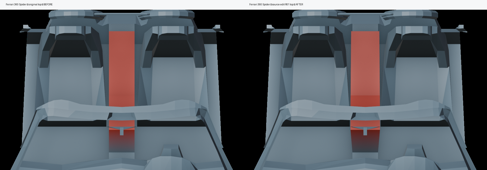
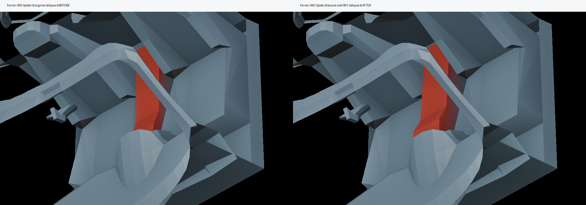

# Ferrari 360 Spider — SLOT A Center Console Original-PMT Geometry R01

- Status: **COVERED_PARTIAL_QA**; whole-car QA: **NOT PASS**
- Original source: N100 read-only `obj_plcar_360sp_pmt.sz` SHA256 `a4b56d6e3ed126bcf2b2c88f149c4daeac124f96b6de2518e88436f618f076e6`
- Input native editable Blender SHA256 `b4f1d071119693172bbf786809da62dce8acb0c84e52d9779a6b1a996654ce57`
- Output editable Blender SHA256 `5dabffb52ae4136b6b72f99c7975b629820f839afec2048e59035cb74d8ee612`
- Changed exactly **16 source-native existing vertices** of `PMT_object00_group01_material010_a0`; 74 other native mesh geometry fingerprints remained identical. No added/deleted faces, no synthetic model.
- Source islands top (1412..1421), left (1384..1389), right (1350..1355): moved only 16 upper-ridge vertices; lower anchors untouched; top +2.5–6.8 cm and shoulder width +1.0–1.4 cm on each side.
- Compared with N100 locally retained Ferrari 360 Spider interior photos `01_interior.jpg`, `02_interior.jpg` and center-tunnel/gear-selector photos `REF12_transmission_1_1976f73709.jpg`, `REF9_transmission_01_d60f697f6.jpg`. The authentic photos show a comparatively higher/defined silver central tunnel/selector bridge. This is a limited geometric first-pass improvement of the *existing low-poly source tunnel*, not a reconstruction of unmodeled switchgear.
- Pixel delta across equivalent isolated original-mesh Blender cameras: top **70,058 / 660,000** pixels; oblique **26,879 / 660,000** pixels (RGB channel delta >3). These are render-change checks, not fidelity scores.
- Actual Blender 4.5.15 SAVE/INDEPENDENT REOPEN + original PMT SHA + all-native mesh IDs + normals/UV/topology + 74 other fingerprints: **PASS**.
- Windshield glass, frame, A-pillars, seals, windshield-adjacent geometry: **0 edits**; steering/dashboard **0 edits**; exterior/wheels **0 edits**.
- Original .sz and private unmodified photos: N100 only. No OVC, OVC3, PMT export, game integration, new textures, PBR, Dino, Model2.
- Remaining blockers: accurate cockpit/photo calibration, per-frame matched in-game driver eye and missing high-detail switchgear. **Full vehicle QA remains NOT PASS.**
- Source edit complete on first dispatch: next assigned region **driver_controls** (no more center-console polishing).

## Before/after native source renders

Top: 

Oblique: 
